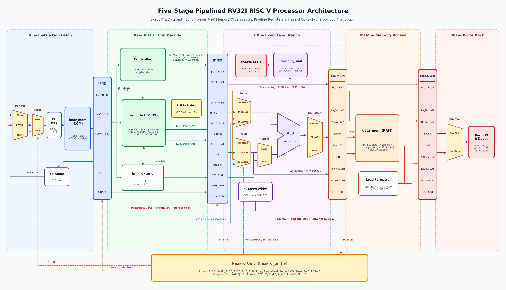
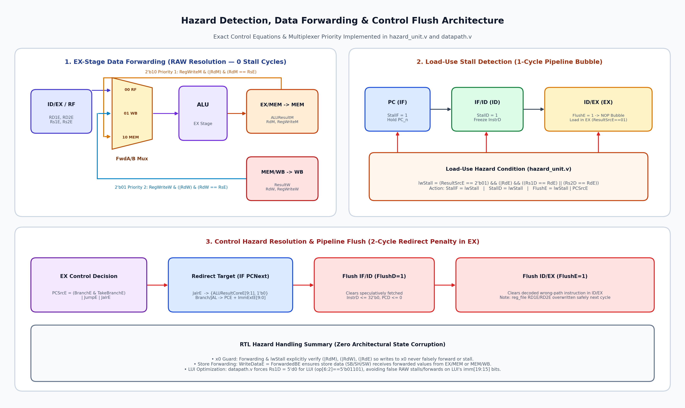
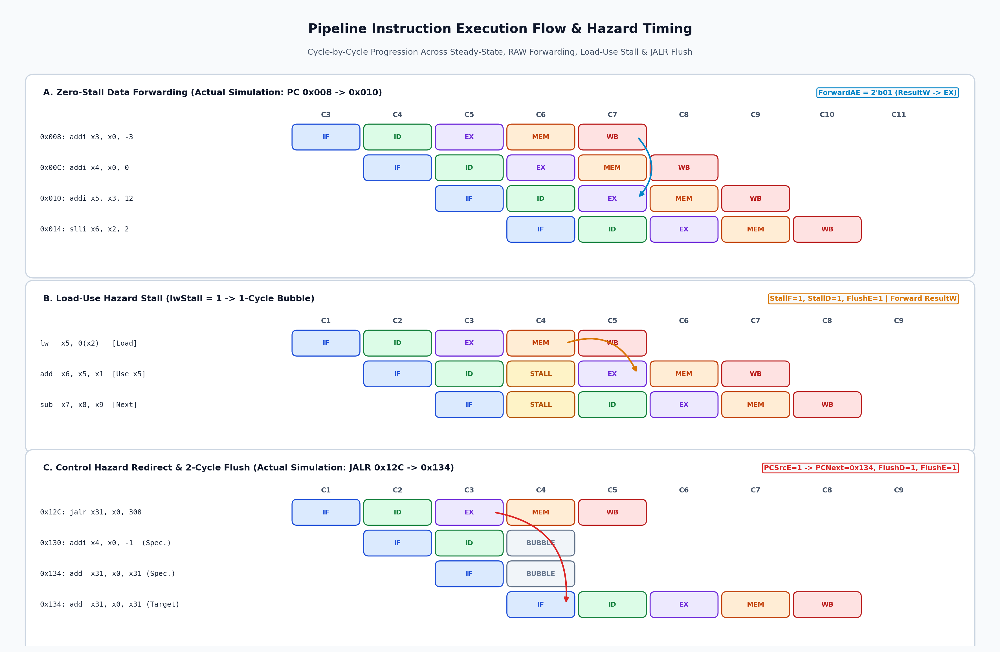
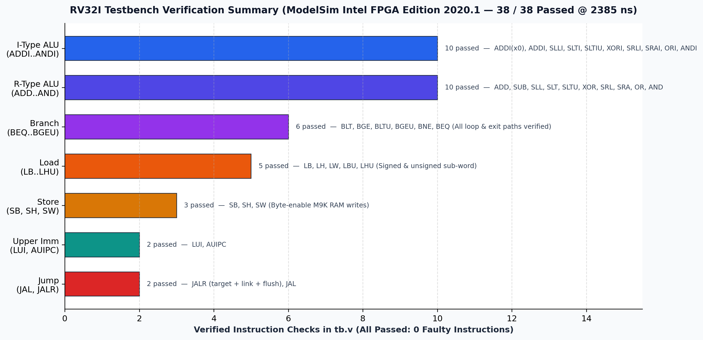
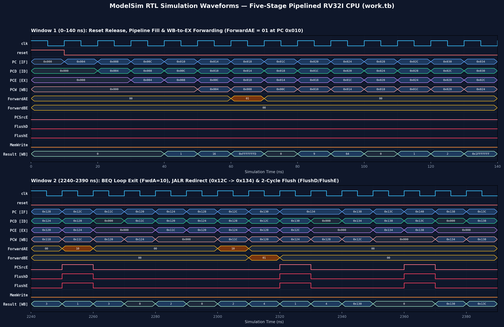

# Five-Stage Pipelined RV32I RISC-V CPU

> Five-stage pipelined RV32I RISC-V processor implemented in Verilog with hazard handling, developed using Quartus Prime and tested on Altera DE1 FPGA.

[](docs/instruction-flow.md)
[](rtl/processor/pl_riscv_cpu.v)
[](docs/architecture.md)
[-2ea44f?style=flat-square)](simulation/modelsim_output.log)
[](#fpga-implementation)
[](LICENSE)

**GitHub Topics:** `risc-v` · `rv32i` · `pipelined-cpu` · `verilog` · `fpga` · `quartus` · `computer-architecture`

---

## Project Overview

This repository presents a synthesizable **five-stage pipelined 32-bit RISC-V processor** implementing the **RV32I** base integer instruction set in Verilog HDL. The processor splits instruction execution across **IF, ID, EX, MEM, and WB** stages separated by custom pipeline registers and coordinated by a dedicated hardware hazard unit supporting **EX/MEM-to-EX and MEM/WB-to-EX data forwarding**, **load-use stalling**, and **branch/jump pipeline flushing**.

Beyond standard textbook pipelining, the RTL incorporates FPGA-aware microarchitectural optimizations:
- **Synchronous M9K Block-RAM Alignment:** `instr_mem`, `data_mem`, and `reg_file` are annotated with `(* ramstyle = "M9K, no_rw_check" *)` and clocked on alternating edges (`negedge clk` / `posedge clk`) so embedded RAM blocks are inferred rather than distributed LUT/flip-flop arrays.
- **Zero-Duplicate Operand Registers:** `reg_file` performs a synchronous `posedge clk` read whose registered outputs (`rd1`, `rd2`) act directly as the `ID/EX` operand registers (`RD1E`, `RD2E`).
- **Compact Datapath Sharing:** A single 33-bit adder/subtractor/comparator and shared 32-bit logarithmic barrel shifter inside `alu` handle arithmetic, shifts, `SLT`/`SLTU`, and branch flag generation (`Zero`, `Lt`, `Ltu`) for `branching_unit`.
- **Full Sub-Word Memory Support:** Byte-enable writes (`SB`, `SH`, `SW`) in `data_mem` and signed/unsigned byte & halfword load formatting (`LB`, `LH`, `LBU`, `LHU`, `LW`) in `datapath`.

Functional verification in **ModelSim - Intel FPGA Edition 2020.1** passes all **38 RV32I instruction test cases** in [`testbench/tb.v`](testbench/tb.v) executing [`simulation/rv32i_test.hex`](simulation/rv32i_test.hex) with **`0` faulty instructions**.

---

## Motivation

In a single-cycle RV32I processor, the clock period is constrained by the worst-case combinational critical path (instruction fetch → register read → ALU → data memory read → register writeback), severely limiting achievable clock frequency ($F_{\max}$) on FPGA fabric.

Designing a pipelined RV32I core from scratch addresses the core challenges of modern RTL processor design:
1. **Throughput vs. Latency:** Dividing the critical path into five balanced stages enables concurrent instruction execution approaching **1 instruction per clock cycle (CPI ≈ 1)** in steady state.
2. **Hardware Hazard Resolution:** Real programs contain Read-After-Write (RAW) dependencies and control-flow changes (`BEQ`–`BGEU`, `JAL`, `JALR`) that must be resolved cleanly in hardware without compiler-inserted NOPs.
3. **FPGA Resource Efficiency:** Structuring memories and pipeline registers (`PCB = 10`, folded `LoadM` flag, shared ALU/shifter, M9K synchronous reads) bridges theoretical computer architecture with practical FPGA synthesis.

---

## RV32I Processor Architecture



At the top level, [`pl_riscv_cpu`](rtl/processor/pl_riscv_cpu.v) wraps the [`riscv_cpu`](rtl/processor/riscv_cpu.v) core alongside [`instr_mem`](rtl/memory/instr_mem.v) and [`data_mem`](rtl/memory/data_mem.v), exposing external reset-time memory initialization ports (`Ext_MemWrite`, `Ext_WriteData`, `Ext_DataAdr`) and writeback-aligned verification signals (`PCW`, `Result`, `ALUResultW`, `WriteDataW`, `MemWrite`).

### Module Hierarchy

```text
pl_riscv_cpu
├── riscv_cpu
│   ├── controller
│   │   ├── main_decoder
│   │   └── alu_decoder
│   └── datapath
│       ├── reset_ff #(10)      (PC register)
│       ├── pl_reg_fd #(10)     (IF/ID pipeline register)
│       ├── reg_file            (32x32 M9K regfile; registered rd1/rd2 = RD1E/RD2E)
│       ├── imm_extend          (I, S, B, J, U immediate generator)
│       ├── pl_reg_de #(10)     (ID/EX pipeline register)
│       ├── alu                 (32-bit ALU + shared barrel shifter)
│       ├── branching_unit      (BEQ, BNE, BLT, BGE, BLTU, BGEU evaluator)
│       ├── pl_reg_em #(10)     (EX/MEM pipeline register)
│       ├── pl_reg_mw #(10)     (MEM/WB pipeline register)
│       └── hazard_unit         (Forwarding, load-use stall & flush control)
├── instr_mem                   (256x32 synchronous M9K ROM)
└── data_mem                    (16x32 byte-enable synchronous M9K RAM)
```

For full signal-level architecture notes, see [docs/architecture.md](docs/architecture.md).

---

## Single-Cycle to Five-Stage Pipeline Evolution

| Design Dimension | Single-Cycle Architecture | This 5-Stage Pipelined RTL |
|---|---|---|
| **Critical Path** | Fetch + Decode + ALU + Data Mem + WB | Single stage latency (e.g., EX ALU + forwarding mux) |
| **Instruction Concurrency** | 1 instruction in flight | Up to 5 instructions in flight simultaneously |
| **Control Signal Lifetime** | Combinational within 1 cycle | Decoded in ID and pipelined via `ID/EX` → `EX/MEM` → `MEM/WB` |
| **Data Dependencies** | Naturally satisfied at cycle boundary | Resolved via `ForwardAE`/`ForwardBE` bypass muxes & `lwStall` |
| **Control Flow Changes** | Next PC updated same cycle | Resolved in EX (`PCSrcE`); flushes 2 wrong-path slots (`FlushD`, `FlushE`) |
| **Memory & RegFile Clocking** | Asynchronous read common in textbooks | Synchronous M9K-friendly `negedge`/`posedge` timing |

---

## Five Pipeline Stages

### 1. IF – Instruction Fetch
- **`pcreg` (`reset_ff #(10)`):** Stores the narrow 10-bit program counter `PC_n` (`localparam PCB = 10`, matching the 256-word / 1 KB instruction memory), zero-extended to `PC[31:0]`.
- **Next-PC Selection:**
  ```verilog
  assign PCSrcE      = (BranchE && TakeBranchE) | JumpE | JalrE;
  assign JALRTargetE = {ALUResultCoreE[PCB-1:1], 1'b0};
  assign PCNext      = JalrE ? JALRTargetE : (PCSrcE ? PCTargetE : PCPlus4F);
  assign PCInput     = StallF ? PC_n : PCNext;
  ```
- **`instr_mem`:** Reads `Instr <= instr_ram[PC[9:2]]` on `negedge clk` so `InstrF` settles before `pl_reg_fd` samples it on the next `posedge clk`.

### 2. ID – Instruction Decode
- **`controller` (`main_decoder` + `alu_decoder`):** Decodes `InstrD[6:0]`, `InstrD[14:12]`, and `InstrD[30]` into `ResultSrcD[1:0]`, `MemWriteD`, `ALUSrcD`, `RegWriteD`, `BranchD`, `JumpD`, `JalrD`, `ImmSrcD[2:0]`, and `ALUControlD[3:0]`.
- **`LUI` Operand Optimization:** `datapath` forces `Rs1D = (InstrD[6:2] == 5'b01101) ? 5'd0 : InstrD[19:15]`, executing `LUI` as `x0 + imm` in the ALU while preventing false RAW hazards on bits `[19:15]`.
- **`imm_extend`:** Sign/zero-extends I, S, B, J, and U immediates into `ImmExtD[31:0]`.
- **`reg_file`:** Writes `wd3` (`ResultW`) on `negedge clk` (ignoring `x0`) and performs a synchronous read on `posedge clk` directly into `RD1E` and `RD2E`.

### 3. EX – Execute
- **Forwarding & Operand Muxing:** 3-to-1 multiplexers controlled by `ForwardAE` and `ForwardBE` select `RD1E`/`RD2E` (`2'b00`), `ResultW` (`2'b01`), or `ALUResultM` (`2'b10`). `SrcBE` chooses between `ImmExtE` (`ALUSrcE = 1`) and `ForwardedBE`. Store data `WriteDataE` also uses `ForwardedBE`.
- **`alu`:** Performs `ADD`, `SUB`, `SLL`, `SLT`, `SLTU`, `XOR`, `SRL`, `SRA`, `OR`, and `AND`, outputting `ALUResultCoreE` plus `ZeroE`, `LtE`, and `LtuE`.
- **Link & Upper-Immediate Muxing (`ALUResultE`):**
  - `ResultSrcE == 2'b10` (`JAL`/`JALR`): forwards rebuilt `PCPlus4E = PCE + 4`.
  - `ResultSrcE == 2'b11` (`AUIPC`): computes `ImmExtE | PCE` (since `ImmExtE[11:0] == 0` and `PC < 4 KB`, bitwise OR replaces a dedicated 32-bit adder).
  - Otherwise: forwards `ALUResultCoreE`.
- **Branch & Target Evaluation:** `PCTargetE = PCE + ImmExtE[9:0]`, while `branching_unit` asserts `TakeBranchE` for `BEQ`, `BNE`, `BLT`, `BGE`, `BLTU`, and `BGEU`.

### 4. MEM – Memory Access
- **`data_mem`:** A 16-word × 32-bit byte-enable RAM (`MEM_SIZE = 16`). Decodes `Store = funct3M` (`3'b000` `SB`, `3'b001` `SH`, `3'b010` `SW`) into 4-bit byte enables `be[3:0]` and steers byte lanes `d0..d3` on `posedge clk`. Reads `ReadData` synchronously on `negedge clk`.
- **Load Data Formatting (`LoadDataM`):** Combinational logic in `datapath` extracts the addressed byte (`ALUResultM[1:0]`) or halfword (`ALUResultM[1]`) and sign-extends (`LB`, `LH`) or zero-extends (`LBU`, `LHU`) based on `Funct3M_int`.

### 5. WB – Write Back
- **Result Selection:** `ResultW = LoadW ? ReadDataW : ALUResultW` (`Result` output).
- **Register Writeback & Verification Alignment:** `ResultW` writes to `reg_file` on `negedge clk` when `RegWriteW = 1` and `RdW != 0`. `pl_reg_mw` carries `PCW`, `ALUResultW`, `WriteDataW`, and `MemWriteW` so the testbench observes commit-stage aligned address/data/PC signals.

---

## Pipeline Register Architecture

| Register | RTL Module | Clocking & Control | Signals Carried | Design Optimization |
|---|---|---|---|---|
| **IF/ID** | [`pl_reg_fd.v`](rtl/pipeline_registers/pl_reg_fd.v) | `posedge clk`, freeze on `en` (`StallD`), sync clear on `clr` (`FlushD`) | `InstrD[31:0]`, `PCD[9:0]` | `PC+4` not pipelined; rebuilt in EX from `PCE` |
| **ID/EX** | [`pl_reg_de.v`](rtl/pipeline_registers/pl_reg_de.v) | `posedge clk`, `en = 1'b0`, sync clear on `clr` (`FlushE`) | `ImmExtE`, `PCE`, `Rs1E`, `Rs2E`, `RdE`, `Funct3E`, `ALUControlE`, `ResultSrcE`, `RegWriteE`, `MemWriteE`, `JumpE`, `BranchE`, `JalrE`, `ALUSrcE` | `RD1E`/`RD2E` live inside `reg_file` synchronous read registers |
| **EX/MEM** | [`pl_reg_em.v`](rtl/pipeline_registers/pl_reg_em.v) | `posedge clk` | `ALUResultM`, `WriteDataM`, `PCM`, `RdM`, `Funct3M`, `LoadM`, `RegWriteM`, `MemWriteM` | Collapses 2-bit `ResultSrcE` to 1-bit `LoadM = (ResultSrcE == 2'b01)` |
| **MEM/WB** | [`pl_reg_mw.v`](rtl/pipeline_registers/pl_reg_mw.v) | `posedge clk` | `ALUResultW`, `ReadDataW`, `WriteDataW`, `PCW`, `RdW`, `LoadW`, `RegWriteW`, `MemWriteW` | Propagates `PCW`, `WriteDataW`, `MemWriteW` for WB-aligned TB checks |

---

## Data Hazard Handling



### Forwarding Mechanism (`hazard_unit.v`)

To resolve Read-After-Write (RAW) hazards without stalling on ALU/LUI/AUIPC/JAL/JALR instructions, [`hazard_unit.v`](rtl/hazard/hazard_unit.v) compares the EX-stage source registers (`Rs1E`, `Rs2E`) against destination registers in MEM (`RdM`) and WB (`RdW`):

```verilog
wire forward_m_a = RegWriteM & (|RdM) & (RdM == Rs1E);
wire forward_w_a = RegWriteW & (|RdW) & (RdW == Rs1E);
wire forward_m_b = RegWriteM & (|RdM) & (RdM == Rs2E);
wire forward_w_b = RegWriteW & (|RdW) & (RdW == Rs2E);

always @(*) begin
    ForwardAE = forward_m_a ? 2'b10 : (forward_w_a ? 2'b01 : 2'b00);
    ForwardBE = forward_m_b ? 2'b10 : (forward_w_b ? 2'b01 : 2'b00);
end
```

- **Priority Rule:** MEM-stage forwarding (`2'b10`, `ALUResultM`) takes priority over WB-stage forwarding (`2'b01`, `ResultW`) so back-to-back writes to the same register always supply the most recent producer value.
- **`x0` Protection:** `(|RdM)` and `(|RdW)` guarantee that instructions targeting `x0` never trigger forwarding.
- **Store Data Forwarding:** `WriteDataE = ForwardedBE` ensures dependent `SB`/`SH`/`SW` store values are forwarded properly.

### Load-Use Stalling (`hazard_unit.v`)

Because load data (`LoadDataM`) is not available until the MEM stage finishes, an instruction in ID that immediately depends on a load currently in EX cannot be satisfied by EX-to-EX forwarding alone. `hazard_unit` detects this condition and inserts a 1-cycle pipeline bubble:

```verilog
assign lwStall = (ResultSrcE == 2'b01) && (|RdE) && ((Rs1D == RdE) || (Rs2D == RdE));
assign StallF  = lwStall;
assign StallD  = lwStall;
assign FlushE  = lwStall | PCSrcE;
```

- `StallF = 1`: Holds `PC_n` via the `PCInput` mux before `pcreg`.
- `StallD = 1`: Disables loading into `pl_reg_fd` (`else if (!en)`), freezing `InstrD` and `PCD`.
- `FlushE = 1`: Clears `pl_reg_de` control/register fields to `0` (NOP bubble) on the next `posedge clk`.

---

## Control Hazard Handling and Branch Flushing

All conditional branches (`BEQ`, `BNE`, `BLT`, `BGE`, `BLTU`, `BGEU`) and unconditional jumps (`JAL`, `JALR`) resolve in the **EX stage** (`PCSrcE = (BranchE && TakeBranchE) | JumpE | JalrE`). The processor assumes sequential fetch (`PCPlus4F`) speculatively until `PCSrcE` is asserted:

- **`FlushD = PCSrcE`:** Clears `pl_reg_fd` (`InstrD <= 32'b0`, `PCD <= 0`), discarding the instruction fetched at `PC + 4`.
- **`FlushE = lwStall | PCSrcE`:** Clears `pl_reg_de` control signals and indices to `0`, discarding the instruction decoded at `PC + 4`.
- **2-Cycle Redirect Penalty:** On any taken branch, `JAL`, or `JALR`, two speculative wrong-path slots are converted into bubbles while `PCNext` immediately fetches from `PCTargetE` or `JALRTargetE`.



For cycle-by-cycle traces from the simulation, see [docs/instruction-flow.md](docs/instruction-flow.md).

---

## Verilog Module Descriptions

| File Path | Module | Stage / Role | Key Details |
|---|---|---|---|
| [`rtl/processor/pl_riscv_cpu.v`](rtl/processor/pl_riscv_cpu.v) | `pl_riscv_cpu` | Top-Level Wrapper | Connects `riscv_cpu`, `instr_mem`, `data_mem`; supports `Ext_MemWrite` during reset and exposes WB-aligned testbench outputs. |
| [`rtl/processor/riscv_cpu.v`](rtl/processor/riscv_cpu.v) | `riscv_cpu` | CPU Core | Connects `controller` (in ID) and `datapath`. |
| [`rtl/processor/datapath.v`](rtl/processor/datapath.v) | `datapath` | 5-Stage Datapath | Implements `PCB=10` PC logic, forwarding muxes, `AUIPC`/`JAL` result mux, load sub-word extension, and stage wiring. |
| [`rtl/processor/controller.v`](rtl/processor/controller.v) | `controller` | Control Unit | Combines `main_decoder` and `alu_decoder`. |
| [`rtl/processor/main_decoder.v`](rtl/processor/main_decoder.v) | `main_decoder` | Main Control Decoder | Decodes `op[6:2]` for R, I-ALU, Load, Store, Branch, `JAL`, `JALR`, `LUI`, `AUIPC`. |
| [`rtl/processor/alu_decoder.v`](rtl/processor/alu_decoder.v) | `alu_decoder` | ALU Control Decoder | Maps `ALUOp`, `op[5]`, `funct3`, `funct7[5]` to 4-bit `ALUControl`. |
| [`rtl/processor/alu.v`](rtl/processor/alu.v) | `alu` | Execute ALU | Shared 33-bit add/sub/compare + shared barrel shifter (`SLL`/`SRL`/`SRA`); outputs `Result`, `Zero`, `Lt`, `Ltu`. |
| [`rtl/processor/branching_unit.v`](rtl/processor/branching_unit.v) | `branching_unit` | Branch Evaluator | Evaluates `BEQ`, `BNE`, `BLT`, `BGE`, `BLTU`, `BGEU` from ALU flags and `funct3`. |
| [`rtl/processor/imm_extend.v`](rtl/processor/imm_extend.v) | `imm_extend` | Immediate Unit | Generates 32-bit sign-extended I, S, B, J, U immediates. |
| [`rtl/processor/reg_file.v`](rtl/processor/reg_file.v) | `reg_file` | 32×32 Register File | M9K synchronous read (`posedge clk`) acting as `RD1E`/`RD2E`; writes on `negedge clk` with `x0` hardwired to 0. |
| [`rtl/processor/reset_ff.v`](rtl/processor/reset_ff.v) | `reset_ff` | Flip-Flop | Parameterized async-reset register instantiated for `pcreg`. |
| [`rtl/processor/adder.v`](rtl/processor/adder.v), [`mux2.v`](rtl/processor/mux2.v), [`mux3.v`](rtl/processor/mux3.v), [`mux4.v`](rtl/processor/mux4.v) | `adder`, `mux2`, `mux3`, `mux4` | Component Primitives | Preserved parameterized combinational primitives from the original component library. |
| [`rtl/pipeline_registers/pl_reg_fd.v`](rtl/pipeline_registers/pl_reg_fd.v) | `pl_reg_fd` | IF/ID Register | Stalls on `en` (`StallD`), clears on `clr` (`FlushD`). |
| [`rtl/pipeline_registers/pl_reg_de.v`](rtl/pipeline_registers/pl_reg_de.v) | `pl_reg_de` | ID/EX Register | Latches decoded controls, immediates, PC, and `Rs1E`/`Rs2E`/`RdE`; clears on `FlushE`. |
| [`rtl/pipeline_registers/pl_reg_em.v`](rtl/pipeline_registers/pl_reg_em.v) | `pl_reg_em` | EX/MEM Register | Latches `ALUResultM`, `WriteDataM`, `PCM`, `RdM`, `Funct3M`, `LoadM`, `RegWriteM`, `MemWriteM`. |
| [`rtl/pipeline_registers/pl_reg_mw.v`](rtl/pipeline_registers/pl_reg_mw.v) | `pl_reg_mw` | MEM/WB Register | Latches WB operands and TB-aligned `PCW`, `WriteDataW`, `MemWriteW`. |
| [`rtl/hazard/hazard_unit.v`](rtl/hazard/hazard_unit.v) | `hazard_unit` | Hazard & Forwarding | Generates `ForwardAE`, `ForwardBE`, `StallF`, `StallD`, `FlushD`, `FlushE`. |
| [`rtl/memory/instr_mem.v`](rtl/memory/instr_mem.v) | `instr_mem` | Instruction ROM | 256×32 M9K ROM (`negedge clk` read), initialized via `$readmemh("rv32i_test.hex", instr_ram)`. |
| [`rtl/memory/data_mem.v`](rtl/memory/data_mem.v) | `data_mem` | Data RAM | 16×32 byte-enable M9K RAM (`posedge clk` write, `negedge clk` read). |

---

## Simulation and Verification

### Verification Methodology

Verification is driven by [`testbench/tb.v`](testbench/tb.v), which instantiates `pl_riscv_cpu`, applies a 10 ns clock (`#5` high / `#5` low) and 10 ns active-high reset, and monitors `PCW`, `Result`, `DataAdrW`, `WriteDataW`, and `MemWrite` on every `negedge clk` against expected architectural results for [`simulation/rv32i_test.s`](simulation/rv32i_test.s) (compiled to [`simulation/rv32i_test.hex`](simulation/rv32i_test.hex)).

### Observed Simulation Results (ModelSim 2020.1)

Running [`simulation/run_sim.do`](simulation/run_sim.do) in **ModelSim - Intel FPGA Edition 2020.1**:
- **Compilation:** `0 Errors, 0 Warnings` across all 22 RTL files and `tb.v`.
- **Instruction Checks Passed:** **`38 / 38`** (`Faulty Instructions => 0`, `No errors encountered, congratulations!` at `2385 ns`).
- **Log Output:** Saved in [`simulation/modelsim_output.log`](simulation/modelsim_output.log).



### Waveform Evidence (Captured from Real ModelSim VCD)



**Key Verified Behaviors in the Waveforms & Trace:**
1. **WB-to-EX Forwarding (`t = 65 ns`):** `PC 0x008` (`addi x3, x0, -3`) in WB forwards `Result = 0xFFFFFFFD` via `ForwardAE = 2'b01` to `PC 0x010` (`addi x5, x3, 12`) in EX, producing `x5 = 9` with zero stall cycles.
2. **MEM-to-EX Forwarding & Branch Loop Resolution (`t = 2255 ns`, `t = 2305 ns`):** Loop counters (`addi x16, x16, 1` at `0x120`) forward directly via `ForwardAE = 2'b10` into the `BEQ` comparison (`0x124`), followed by `ForwardBE = 2'b01` at `0x128`.
3. **2-Cycle Control Hazard Flush (`t = 2325–2345 ns`):** `jalr x31, x0, 308` at `0x12C` asserts `PCSrcE = 1`, `FlushD = 1`, and `FlushE = 1`, redirecting `PC` to `0x134` while flushing the speculatively fetched `0x130` (`addi x4, x0, -1`) into NOP bubbles (`PCD = 0x000`, `PCE = 0x000`) and writing link address `0x130` to `x31`.

> **Verification Scope Note:** While `lwStall` logic is implemented in [`hazard_unit.v`](rtl/hazard/hazard_unit.v) and wired to `StallF`, `StallD`, and `FlushE`, the provided `rv32i_test.s` program places non-dependent instructions immediately after `lb`–`lhu` (`0x70`–`0x80`), so `lwStall` stays `0` during `rv32i_test.hex` execution. Extending `tb.v` with a dedicated load-use test sequence is listed under [Future Improvements](#future-improvements).

---

## FPGA Implementation

- **Target Hardware & Toolchain:** Developed using **Intel Quartus Prime** targeting the **Altera DE1 FPGA** board, with RTL simulation verified using **ModelSim - Intel FPGA Edition 2020.1**.
- **FPGA-Targeted RTL Design Choices:**
  - `(* ramstyle = "M9K, no_rw_check" *)` directives on `instr_mem`, `data_mem`, and `reg_file` enable embedded memory block inference instead of logic-cell arrays.
  - Alternating-edge synchronous reads (`negedge clk` for instruction/data memories, `posedge clk` for `reg_file` read ports) keep single-cycle memory access aligned with pipeline register boundaries.
  - `PCB = 10` avoids synthesizing 22 unused upper PC flip-flops across four pipeline stages for the 1 KB instruction ROM.
- **Repository Snapshot Note:** Quartus project files (`.qpf`/`.qsf`), board pin-assignment/SDC constraint files, and synthesis resource/`Fmax` reports are not included in this repository snapshot and are intended to be added once board-level I/O mapping is exported.

---

## Tools and Technologies

| Category | Tool / Technology | Role in Project |
|---|---|---|
| **HDL** | Verilog-2001 | RTL implementation of processor core, pipeline registers, hazard unit, and memories |
| **ISA** | RISC-V RV32I | Base 32-bit unprivileged integer instruction set |
| **Simulation** | ModelSim - Intel FPGA Edition 2020.1 | Functional RTL compilation, waveform capture, and automated `tb.v` verification |
| **Synthesis / FPGA** | Intel Quartus Prime & Altera DE1 | Target FPGA synthesis environment and embedded RAM architecture |
| **Documentation & Plots** | Python (`matplotlib`) | Architecture schematics and VCD-backed simulation waveform rendering |

---

## Repository Structure

```text
riscv_pipelined_cpu/
├── README.md
├── LICENSE
├── .gitignore
├── rtl/
│   ├── processor/
│   │   ├── pl_riscv_cpu.v         # Top-level CPU + memory wrapper
│   │   ├── riscv_cpu.v            # Core wrapper (controller + datapath)
│   │   ├── datapath.v             # 5-stage pipelined datapath
│   │   ├── controller.v           # Instruction & ALU control top
│   │   ├── main_decoder.v         # Opcode decoder
│   │   ├── alu_decoder.v          # ALU operation decoder
│   │   ├── alu.v                  # 32-bit ALU + shared barrel shifter
│   │   ├── branching_unit.v       # 6-mode RV32I branch evaluator
│   │   ├── imm_extend.v           # I/S/B/J/U immediate extender
│   │   ├── reg_file.v             # 32x32 M9K register file
│   │   ├── reset_ff.v             # Parameterized resettable D flip-flop
│   │   ├── adder.v                # Parameterized adder primitive
│   │   ├── mux2.v                 # 2-to-1 multiplexer primitive
│   │   ├── mux3.v                 # 3-to-1 multiplexer primitive
│   │   └── mux4.v                 # 4-to-1 multiplexer primitive
│   ├── pipeline_registers/
│   │   ├── pl_reg_fd.v            # IF/ID pipeline register
│   │   ├── pl_reg_de.v            # ID/EX pipeline register
│   │   ├── pl_reg_em.v            # EX/MEM pipeline register
│   │   └── pl_reg_mw.v            # MEM/WB pipeline register
│   ├── hazard/
│   │   └── hazard_unit.v          # Forwarding, load-use stall & flush control
│   └── memory/
│       ├── instr_mem.v            # 256x32 synchronous instruction ROM
│       └── data_mem.v             # 16x32 byte-enable synchronous data RAM
├── testbench/
│   └── tb.v                       # Self-checking RV32I testbench (38 checks)
├── simulation/
│   ├── rv32i_test.s               # RV32I assembly verification program
│   ├── rv32i_test.hex             # Machine code hex loaded by instr_mem.v
│   ├── run_sim.do                 # ModelSim batch/GUI compilation & run script
│   └── modelsim_output.log        # Captured ModelSim 2020.1 verification log
├── docs/
│   ├── architecture.md            # Detailed RTL microarchitecture reference
│   └── instruction-flow.md        # Pipeline stage progression & VCD traces
└── images/
    ├── architecture/
    │   ├── five_stage_architecture.png
    │   ├── hazard_forwarding_paths.png
    │   └── instruction_execution_flow.png
    └── simulation/
        ├── modelsim_waveform.png
        └── verification_coverage.png
```

---

## How to Run the Project

### Option 1: ModelSim CLI (Verified on ModelSim - Intel FPGA Edition 2020.1)

Run from the `simulation/` directory so `instr_mem.v` locates `rv32i_test.hex` automatically:

```bash
cd simulation
vsim -c -do run_sim.do
```

Expected output tail:
```text
# 37. jalr implementation is correct 
# 38. jal implementation is correct 
# Faulty Instructions =>           0
# No errors encountered, congratulations!
```

### Option 2: ModelSim GUI (Interactive Waveforms)

```tcl
cd <repo_root>/simulation
do run_sim.do
```

Remove `quit -f` from `run_sim.do` (or inspect `work.tb` in the Wave window before exiting) to browse internal pipeline signals interactively.

---

## Future Improvements

1. **Targeted Load-Use & Back-to-Back Hazard Test Suite:** Add assembly tests exercising adjacent `lw` → ALU/branch dependencies to directly verify `lwStall = 1` (`StallF`, `StallD`, `FlushE`) in simulation alongside the existing 38 ISA tests.
2. **Quartus Prime Project & DE1 Pin Constraints:** Commit `.qpf`, `.qsf`, and `.sdc` timing constraints for Altera DE1 FPGA along with Synthesis/TimeQuest resource utilization and $F_{\max}$ reports.
3. **Static Branch Prediction / Early Branch Resolution:** Move branch comparison to ID or add a 2-bit BTB/saturating predictor to reduce the current 2-cycle branch redirect penalty.
4. **ISA & System Extensions:** Expand memory capacity (`MEM_SIZE`), add memory-mapped I/O peripherals (UART/7-segment/LEDs on DE1), and implement `CSR`/`ECALL`/`EBREAK` support or RV32M multiply/divide extensions.
